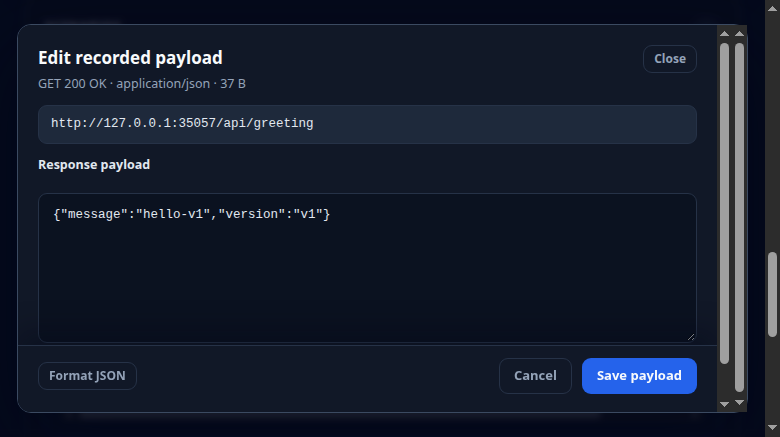

# API Recorder — Chrome extension

Record the XHR/fetch traffic of a web page into a named **scenario**, then replay the recorded
responses later — per tab, per request body — without the application noticing. A **Live mode**
button puts every request back on the real network at any time.

Built as a Manifest V3 extension using the Chrome Debugger API (CDP): recording is passive, replay
fulfills requests at the network layer, so no page-side monkey-patching is involved.


## Features

- **Scenario recording** — name a scenario, press *Start recording*, use the page normally. Every
  `fetch`/`XMLHttpRequest` response is stored with its request body, status, status text, MIME type
  and response headers.
- **Body-aware matching** — a recording is identified by `METHOD + normalized URL + exact request
  body`. `POST /api/items {"id":1}` and `POST /api/items {"id":2}` are two independent recordings.
- **Transparent replay** — while a scenario replays, matching requests are answered with the stored
  status/headers/body exactly as the server would have answered. Non-matching requests pass through
  live, so the app keeps working.
- **Smart fallback matching + live-pass diagnostics** — if no exact recording matches, replay falls
  back to the only recording for the same URL (or same path, ignoring query strings) when that choice
  is unambiguous. Requests that still go live are listed in the popup with the reason (no recording,
  body differs, ambiguous, …), and Settings → Troubleshooting can copy a debug report.
- **Editable payloads** — in Settings → Scenarios → *View requests*, every recorded request has an
  **Edit** button that opens the response payload in a dialog. Edit and save it to test different
  response shapes; the original payload is kept and can be restored with one click. Replay picks up
  edits immediately, even while a replay session is active.

  
- **Per-tab sessions** — a tab can record while another tab replays. A session survives page reloads
  on allowlisted sites and is bound to the tab it was started in.
- **Live mode** — one click disables replay interception on that tab; every request goes to the real
  network. Switching back to replay is instant and keeps the scenario selected.
- **Live counters** — toolbar badge (red = recording count, blue = replayed count, gray `LIVE`), plus
  an in-page HUD with recorded / replayed / passed-live counters and a recent-request feed.
- **Site allowlist** — the extension only runs on sites you add in Settings (per-host optional
  permissions). Nothing is injected into pages you did not enable.
- **GraphQL excluded** — GraphQL-looking requests (URL contains `graphql`, a `query` parameter, or a
  body containing a GraphQL `query`/`mutation`) are never recorded or replayed; they always go live.
  Can be toggled in Settings.
- **Only fetch/XHR** — documents, scripts, stylesheets, images, fonts, media, EventSource and
  WebSocket traffic are never recorded (and are only briefly paused during replay, then forwarded).

## Install (unpacked, developer mode)

1. Open `chrome://extensions` and enable **Developer mode**.
2. Click **Load unpacked** and select this folder.
3. Pin **API Recorder** to the toolbar.

Chrome asks for the *debugger* permission at install time (needed for CDP) and shows an
"An extension is debugging this browser" infobar while a session is active. Host access is requested
per site, the first time you add it.

## Quick start

1. Open **Settings** (popup → Settings) and add the site you want to work with, e.g. `app.example.com`
   or `localhost:3000`. Chrome asks for host access; accept.
2. Open the page, click the extension icon.
3. Type a scenario name and press **Create**, then **Start recording**. The badge and in-page HUD
   show how many requests have been captured.
4. Use the page to trigger the API calls you care about, then press **Stop recording** (HUD or
   popup). The requests are already saved at that point.
5. Select the scenario and press **Start replay**, then reload/interact with the page. Matching
   requests are served from the recording (no server hit); everything else goes live.
6. Press **Go live** in the HUD (or popup) to bypass the recording, and **Resume replay** to return.
7. To test a different response, open **Settings → Scenarios → View requests**, press **Edit** next
   to a request, change the payload and press **Save payload**. Replay now serves the edited body;
   **Restore original** brings the recorded body back.

## How it works

- **Recording** attaches `chrome.debugger` and enables the CDP `Network` domain. On
  `requestWillBeSent` → `responseReceived` → `loadingFinished`, only resources of type `XHR`/`Fetch`
  are kept. The exact request body is read with `Network.getRequestPostData` and the response body
  with `Network.getResponseBody`; the pair is written to IndexedDB. Nothing is blocked, so recording
  cannot break the page.
- **Replay** enables the CDP `Fetch` domain (request stage). Each paused request is matched against
  an in-memory `matchKey → entry` index; a hit is fulfilled via `Fetch.fulfillRequest`, a miss is
  forwarded via `Fetch.continueRequest`. Stored response bodies are decompressed already, so
  `content-encoding`/`content-length`/`transfer-encoding` are dropped before fulfillment; `Set-Cookie`
  is not replayed by default (toggle in Settings).
- **Live mode** disables the `Fetch` domain, leaving the debugger attached, so toggling back is
  instant.
- **Payload editing** rewrites the stored response body in IndexedDB (the first edit keeps a copy of
  the original body) and refreshes the match index/cache of active replay sessions for that scenario,
  so the next intercepted request gets the new bytes. Status and response headers stay unchanged;
  the browser recalculates `content-length` when fulfilling.
- **Per-tab sessions** are tracked in the service worker and snapshotted to `chrome.storage.session`,
  so a restarted service worker can reattach and recover. A keepalive ping from the in-page HUD keeps
  the MV3 worker alive while a session is active.

```
manifest.json
src/
  background/        service worker: message API, session lifecycle, CDP engines, storage
    service-worker.js  message router + chrome event wiring + state snapshot
    sessions.js        one session per tab, badge/broadcasts/recovery, engine hooks
    recorder.js        passive CDP Network recorder
    replay.js          CDP Fetch interceptor + fulfill/continue
    db.js              IndexedDB metadata + response body stores
    store.js           chrome.storage for sites/scenarios/settings
    sites.js           optional host permissions + dynamic content-script registration
    cdp.js             chrome.debugger wrapper with friendly errors
    broadcast.js       tab/extension-page broadcasts
  content/overlay.js   in-page HUD (shadow DOM)
  popup/               toolbar popup: scenario management, record/replay/live, enable site
  options/             settings page: sites, settings, scenario management
  shared/              pure helpers: match keys, URL normalization, headers, patterns, entry bodies,
                       messages
test/unit/             Node test runner tests for the pure logic
test/e2e/              real Chrome for Testing end-to-end suite
```

### Matching rules

| Request | Key |
| --- | --- |
| `GET /api/items?b=2&a=1` | `GET` + `…/api/items?a=1&b=2` + empty body |
| `POST /api/items {"id":1}` | `POST` + `…/api/items` + `{"id":1}` bytes |
| `POST /api/items {"id":2}` | `POST` + `…/api/items` + `{"id":2}` bytes (different entry) |

The fragment is ignored and query parameters are sorted; the body is compared byte-for-byte. Bodies
above 2 MB are skipped during recording because they cannot be keyed reliably. If a request body
cannot be observed by Chrome, that request is not recorded (recording never stores an ambiguous key).

On replay the lookup is tiered to survive real-world APIs that embed timestamps/tokens in bodies or
cache-busting values in query strings:

1. **exact** — method + normalized URL + exact request body (the recorded key).
2. **same URL** — method + normalized URL, used only when exactly one recording exists for it.
3. **same endpoint** — method + origin + path, ignoring the query string, used only when exactly one
   recording exists for it.

Fallback tiers are controlled by the **Smart fallback matching** setting (on by default) and never
guess: if several recordings could apply, the request goes live and the popup reports it. Disable the
setting for strict exact matching.

## Data & privacy

Everything is stored locally in the extension (`chrome.storage.local` for metadata, IndexedDB for
recorded bodies; `unlimitedStorage` is requested so scenarios are not size-constrained). Nothing is
uploaded anywhere. Deleting a scenario permanently removes its recorded data.

## Limitations / troubleshooting

- **DevTools cannot be open on the tab** while recording/replaying (Chrome allows one debugger client
  per tab). Close DevTools for that tab and retry. Other debugger extensions conflict too.
- The **debugger infobar** is shown while a session is active; that is Chrome's requirement for the
  Debugger API.
- Recording covers `fetch` and `XMLHttpRequest` of the page and its frames. Requests made by service
  workers or dedicated workers are not captured. WebSockets are out of scope. EventSource responses
  are skipped.
- Cross-origin requests still perform their CORS preflight against the real server; recorded CORS
  headers are replayed so the actual request/response works offline from the recording.
- Navigating a recording/replay tab to a site that is not allowlisted stops the session (recorded
  data is kept). The same happens if the page is closed or DevTools/replaced debugger detaches.
- Binary response bodies cannot be edited as text (the dialog explains this); text formats such as
  JSON, XML, HTML and plain text are fully editable. Edits are written byte-for-byte and are not
  JSON-validated, so you can intentionally test malformed payloads (the dialog warns about invalid
  JSON but still lets you save).
- Chrome match patterns ignore ports: adding `localhost:3000` allowlists every port on `localhost`.
- `start`/`stop` are per tab. One active session per tab; switching modes stops the previous one.

### Replay reports requests as “stayed live”

1. Keep the popup open briefly during replay: the Session card shows **“N requests stayed live”**.
   Expand it to see the method, shortened URL and reason for each (no recording, body differs, URL
   differs, ambiguous candidates, body unavailable, replay error).
2. Compare those URLs with **Settings → Scenarios → View requests**. If the recorded URL/body differs
   (dynamic query values, CSRF tokens, timestamps in JSON bodies, redirect targets), keep **Smart
   fallback matching** enabled (default) or re-record the request.
3. If several recordings share an endpoint, matching is refused as ambiguous. Re-record the scenario
   while hitting the endpoint once, or edit/remove the extra recordings.
4. If replay still pass-throughs everything, use **Settings → Troubleshooting → Copy debug report**
(it includes settings, allowed sites, recorded request signatures and live-pass diagnostics), and
   make sure you reloaded the unpacked extension after updating it (chrome://extensions → Reload).

## Development

```bash
npm test            # unit tests (Node built-in test runner, no dependencies)
npm run e2e:install # one-time: download Chrome for Testing into .e2e/ (branded Chrome 137+ can no
                    # longer load unpacked extensions via --load-extension)
npm run test:e2e    # real-Chrome end-to-end suite (CHROME_BIN to override the binary)
npm run verify      # units + e2e
npm run icons       # regenerate icons/
```

The e2e suite drives a real headless Chrome for Testing with the unpacked extension loaded against a
local fixture server and asserts, among others: only XHR/fetch is recorded, two POST bodies to the
same endpoint are stored separately, replayed responses are served from storage while the server
version is bumped to prove no network hit, GraphQL and images stay live, Live mode hits the server,
unrecorded requests pass through, replay can be resumed, counters/badges are correct, and the popup
and options pages load without uncaught errors. The payload editor is exercised through the real
Settings UI: the recorded response is edited, replay serves the edited bytes, the original is restored
from the dialog, and the next replay serves the original again. Smart fallback is covered as well:
an ambiguous request is left live while an unambiguous URL/path match is replayed from storage, and
the popup/debug-report diagnostics are validated (65 checks).

## License

MIT
