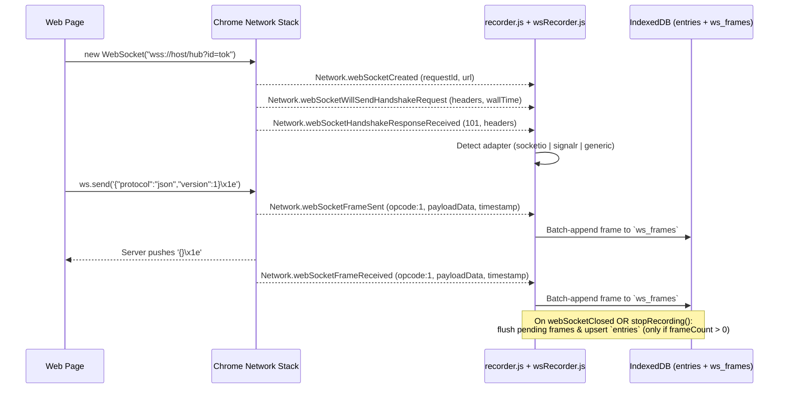
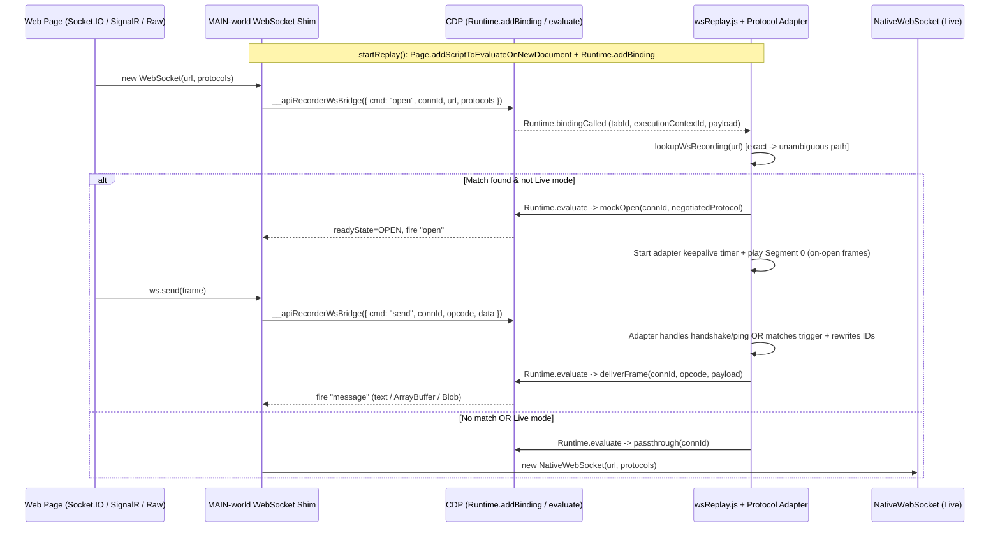
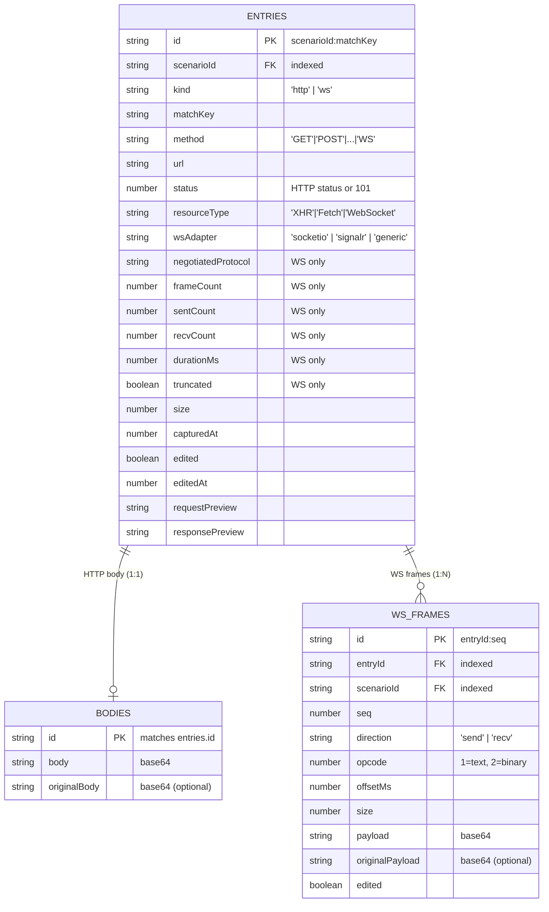

# API Recorder — Project Analysis & Finalized WebSockets Support Plan (v1)

> **Planning & Analysis Only.** This document captures the current architecture of `api-recorder` (v1.2.1) and the finalized design for adding WebSockets support with first-class **Socket.IO** and **SignalR** protocol adapters.

---

## 1. Finalized Design Decisions

| Decision Area | Agreed Choice |
| --- | --- |
| **Protocol Architecture** | **Generic WS core + pluggable protocol adapters** (`Socket.IO` Engine.IO v3/v4 + `SignalR` JSON in v1, plus generic fallback). |
| **Binary Frames (v1)** | Full protocol parsing for text frames (Socket.IO text + SignalR `\x1e`-delimited JSON); **opaque binary** recording & exact-match replay for binary frames (SignalR MessagePack, Socket.IO binary attachments, raw binary WS). |
| **Offline Handshakes** | **Full offline support**: enhance HTTP replay matching for Socket.IO polling (`t`/`sid` volatile params) and SignalR `/negotiate` so scenarios replay cleanly with zero backend running. |
| **Replay Timing & Keepalives** | **Capped relative timing** by default (delays capped at `1500 ms`; configurable to `original` or `instant`) + **automatic synthetic keepalives** (Socket.IO ping/pong & SignalR `{"type":6}\x1e`). |
| **Dynamic Correlation IDs** | When `smartFallback` is enabled, auto-rewrite **SignalR `invocationId`**, **Socket.IO ack IDs**, and common generic JSON IDs (`id`, `reqId`, `requestId`, `seq`, `correlationId`). |
| **Live Mode Transition** | On **Go live**, close active mocked sockets with code `1001` (Going Away) so Socket.IO / SignalR auto-reconnects to the real server immediately; all new sockets pass through live. |
| **GraphQL Exclusion** | Existing `skipGraphql` setting also skips `graphql-ws`, `graphql-transport-ws`, and WS URLs containing `graphql`. |
| **Reconnect Storage Policy** | **Latest non-empty connection wins** per normalized WS endpoint (0-frame or failed reconnects never overwrite a good recording). |
| **UI Frame Editor (v1)** | Filterable chronological frame timeline + **edit / restore / delete** individual text frames with Socket.IO & SignalR payload pretty-printing. |

---

## 2. Current Project Analysis

### 2.1 High-Level Overview

**API Recorder** is a zero-dependency Chrome Manifest V3 extension (`minimum_chrome_version: 116`, Node >= 20 for tests) that records `fetch` and `XMLHttpRequest` traffic into named **scenarios** and replays them transparently per tab, keyed by `METHOD + normalized URL + exact request body`.

- **Permissions** (`manifest.json`): `debugger`, `storage`, `scripting`, `activeTab`, `unlimitedStorage`, plus `optional_host_permissions` (`http://*/*`, `https://*/*`). No new manifest permissions are needed for WebSockets.
- **Core Philosophy**:
  - Passive recording via Chrome DevTools Protocol (`chrome.debugger`).
  - Per-tab session isolation (Tab A can record while Tab B replays and Tab C is idle).
  - Pure, Chrome-free modules under `src/shared/` unit-tested directly with `node --test`.
  - Real headless Chrome for Testing E2E suite (`test/e2e/run.mjs`) with a zero-dependency fixture server (`test/e2e/server.mjs`).

### 2.2 Module Map

| Layer | File | Responsibility |
| --- | --- | --- |
| **Background (SW)** | `src/background/service-worker.js` | Message router (`chrome.runtime.onMessage`), Chrome event wiring, state snapshot builder, CRUD/import/export handlers. |
| | `src/background/sessions.js` | Per-tab session state machine (`recording` / `replay` / `live`), badge updates, HUD/extension broadcasts, debounced host tracking, `chrome.storage.session` crash recovery. |
| | `src/background/recorder.js` | Passive CDP `Network` engine (`requestWillBeSent` → `responseReceived` → `loadingFinished`). Filters to `XHR`/`Fetch`, skips `text/event-stream` and GraphQL, writes entries + base64 bodies to IDB. |
| | `src/background/replay.js` | CDP `Fetch` interceptor (`Fetch.requestPaused`). Matches via tiered `matchIndex`, fulfills hits via `Fetch.fulfillRequest`, forwards misses via `Fetch.continueRequest`. Live mode disables `Fetch` while keeping debugger attached. |
| | `src/background/cdp.js` | `chrome.debugger` wrapper (`attach`, `detach`, `sendCommand`, `ensureAttached`, `canReachSession`, friendly errors). |
| | `src/background/db.js` | IndexedDB (`api-recorder-db` v1) with `entries` (metadata, indexed by `scenarioId`) and `bodies` (base64 `body` + optional `originalBody`). |
| | `src/background/store.js` | `chrome.storage.local` for `sites`, `scenarios`, `settings`; `chrome.storage.session` for `tabSessions`. |
| | `src/background/sites.js` | Optional host permissions + dynamic `chrome.scripting` registration for the HUD. |
| | `src/background/broadcast.js` | `chrome.tabs.sendMessage` + `chrome.runtime.sendMessage` wrappers (`__broadcast: true`). |
| **Content** | `src/content/overlay.js` | Self-contained Shadow DOM HUD injected at `document_start`, plus 15s `KEEPALIVE` pings. |
| **UI Pages** | `src/popup/popup.js` | Toolbar popup: enable site, host-filtered scenario selector, session controls, live-pass diagnostics. |
| | `src/options/options.js` | Settings tab: sites, settings, scenarios, export/import, filterable request table, payload editor modal, debug report. |
| **Shared (Pure)** | `src/shared/constants.js`, `matchkey.js`, `matchIndex.js`, `url.js`, `entryBody.js`, `scenarioTransfer.js`, `filterEntries.js`, `scenarioHosts.js` | Pure logic for keys, tiered matching, URL normalization, payload editing, v1 JSON import/export, filtering, and host tracking. |

---

## 3. Core Technical Challenge: CDP Asymmetry for WebSockets

| Capability | HTTP (`XHR`/`Fetch`) | WebSockets (`ws://`/`wss://`) |
| --- | --- | --- |
| **Recording** | CDP `Network` (`requestWillBeSent` → `loadingFinished`) | **CDP `Network` natively** (`webSocketCreated`, `webSocketWillSendHandshakeRequest`, `webSocketHandshakeResponseReceived`, `webSocketFrameSent`, `webSocketFrameReceived`, `webSocketFrameError`, `webSocketClosed`) |
| **Replay** | CDP `Fetch` (`Fetch.fulfillRequest` / `Fetch.continueRequest`) | **NOT supported by CDP `Fetch`.** Requires a **MAIN-world `window.WebSocket` shim** injected via the existing CDP session (`Page.addScriptToEvaluateOnNewDocument` + `Runtime.addBinding`). |

### Why CDP `Page.addScriptToEvaluateOnNewDocument` + `Runtime.addBinding`

1. **Per-tab isolation**: Only affects the tab being replayed (not other tabs on the same origin).
2. **CSP & Trusted Types safe**: CDP injection bypasses strict page CSP headers.
3. **Zero `window.postMessage` pollution**: Uses `Runtime.addBinding` (Page → SW) and `Runtime.evaluate` (SW → Page) via a hidden symbol, so app `message` listeners are never disturbed.
4. **Runs before any page script (including iframes)** and cleans up via `Page.removeScriptToEvaluateOnNewDocument` when replay stops.

---

## 4. Target Architecture Diagrams

### 4.1 Recording Flow (100% Passive CDP)



### 4.2 Replay Flow (CDP Bridge + MAIN-World Shim + Protocol Adapters)



---

## 5. Detailed Design

### 5.1 Pluggable Protocol Adapters (`src/shared/wsAdapters/`)

A pure, unit-testable adapter interface lets the generic WS engine delegate protocol-specific detection, framing, keepalives, and ID rewriting:

```js
// Conceptual interface in src/shared/wsAdapters/index.js
{
  name: 'socketio' | 'signalr' | 'generic',
  detect({ url, protocols, firstSentFrame, firstRecvFrame }): boolean,
  splitFrame(rawText): LogicalMessage[],          // e.g. SignalR splits on '\x1e'
  joinMessages(messages): string,                 // e.g. SignalR joins with '\x1e'
  isControlOrKeepalive(msg, direction): boolean,  // filter out noise from trigger matching
  handleControlMessage(msg, ctx): string[] | null,// immediate synthetic replies (2probe->3probe, handshake->{}\x1e, ping->pong)
  startKeepalive(ctx, sendServerFrame): () => void, // synthetic keepalive timer
  matchSignature(msg): { key: string, correlationId?: string } | null,
  rewriteCorrelationId(recordedRecvMsg, recordedSendId, liveSendId): string,
  prettyPrint(rawText): string,                   // for the Settings frame editor
}
```

#### Adapter 1: Socket.IO (`src/shared/wsAdapters/socketio.js`)
- **Detection**: URL path contains `/socket.io` OR query has `EIO=` & `transport=websocket`, OR first frames match Engine.IO packet prefixes (`2probe` / `3probe` / `0{` / `40`).
- **Engine.IO v3 & v4 Control Handling**:
  - Client `2probe` → immediate server reply `3probe`.
  - Client `5` (upgrade) → acknowledged (no reply needed; start playing recorded post-upgrade server pushes).
  - Engine.IO v4 keepalive: server sends `2` every `pingInterval` (parsed from handshake or default `20000 ms`), client replies `3` (absorbed silently so it doesn't count as an unmatched frame).
  - Engine.IO v3 keepalive: client sends `2` → immediate server reply `3`.
  - Socket.IO namespace connect: client `40` or `40/ns,{...}` → match recorded `40` reply (or synthesize `40{"sid":"replay-sid"}` if needed).
- **Event & Ack Matching**:
  - Parse Socket.IO packet: `42[ackId?]["eventName", ...args]` (and namespace prefix `/ns,`).
  - `matchSignature`: normalized event name + arguments (with `ackId` stripped).
  - **Ack ID rewriting**: If client sends `427["getOrders",123]` and recorded was `423["getOrders",123]` → `433[[...]]`, rewrite response to `437[[...]]`.
- **Binary Attachments**: `451-[...]` followed by a binary frame (`opcode: 2`) — preserved verbatim in order via opaque binary frame replay.

#### Adapter 2: ASP.NET Core SignalR (`src/shared/wsAdapters/signalr.js`)
- **Detection**: First sent text frame ends with `\x1e` (0x1e) and parses as `{"protocol":"json","version":...}` (or `{"protocol":"messagepack",...}`), OR URL matches a recorded `/negotiate` hub path.
- **Record-Separator Framing (`\x1e`)**:
  - A single WebSocket text frame may contain **multiple** `\x1e`-delimited JSON messages. `splitFrame` splits on `\x1e` so each logical SignalR message is matched, edited, and replayed cleanly, then terminated with `\x1e` on delivery.
- **Handshake & Keepalive**:
  - Client `{"protocol":"json","version":1}\x1e` → immediate server reply `{}\x1e` (or recorded handshake response if it had an error).
  - Client `{"type":6}\x1e` (ping) → absorbed silently.
  - Synthetic server keepalive: send `{"type":6}\x1e` every `15000 ms` so the SignalR client never triggers `serverTimeoutInMilliseconds` (default 30s) disconnect.
- **Invocation & Streaming Matching**:
  - `type: 1` (Invocation): `{"type":1,"invocationId":"5","target":"GetOrders","arguments":[...]}`
    - `matchSignature`: `target` + serialized `arguments` (ignoring `invocationId`).
    - **InvocationId rewriting**: All triggered `type: 2` (StreamItem) and `type: 3` (Completion) responses have their `invocationId` rewritten from the recorded ID to the live `"5"`.
  - `type: 4` (StreamInvocation) & `type: 5` (CancelInvocation): supported via the same `invocationId` mapping.
- **MessagePack (`protocol: "messagepack"`)**: Handshake frame is JSON `\x1e`, subsequent frames are binary (`opcode: 2`) — replayed via opaque binary exact-match in v1.

#### Adapter 3: Generic (`src/shared/wsAdapters/generic.js`)
- Handles any standard text/binary WebSocket:
  - Exact frame match first.
  - When `smartFallback` is on and both frames are JSON objects: match by structural discriminator (`type`, `action`, `event`, `method`, `op`, `topic`) and rewrite common correlation IDs (`id`, `reqId`, `requestId`, `seq`, `correlationId`) when the recorded response echoed the recorded request's ID.

---

### 5.2 Offline HTTP Handshake Support (`src/shared/matchIndex.js` & `src/background/replay.js`)

To ensure **offline replay** works end-to-end for Socket.IO and SignalR:

1. **Socket.IO HTTP Polling Handshake**:
   - Real Socket.IO clients issue a sequence of HTTP calls before upgrading:
     1. `GET /socket.io/?EIO=4&transport=polling&t=<rand1>` → `0{"sid":"<sid>",...}`
     2. `POST /socket.io/?EIO=4&transport=polling&t=<rand2>&sid=<sid>` (body `40`) → `ok`
     3. `GET /socket.io/?EIO=4&transport=polling&t=<rand3>&sid=<sid>` → `40{"sid":"..."}`
   - **Problem today**: `t=` is a random cache-buster on every request, and because there are multiple `GET /socket.io/` entries in the scenario, `lookupRecording` returns `ambiguous-url` and sends them live (failing offline!).
   - **Solution in `matchIndex.js`**:
     - Add a pure helper `canonicalizeHandshakeUrl(url)` for known WS transport handshakes:
       - For Socket.IO polling (`transport=polling`): strip volatile `t` param, and distinguish **initial open** (`!sid`) from **post-open polling** (`has sid`).
       - For SignalR negotiate (`POST .../negotiate`): strip volatile cache-busters if any, match by hub path.
     - For multiple `GET /socket.io/?...&sid=...` polling entries, replay them **in recorded chronological order** (per-session cursor) so step 1 returns the open packet, step 2 accepts `40`, and step 3 returns the namespace connect — allowing the client to smoothly upgrade to WebSocket completely offline.

---

### 5.3 Recording Engine (`src/background/wsRecorder.js`)

- Wired into `src/background/recorder.js` (which already runs `Network.enable`).
- **Events**: `Network.webSocketCreated`, `Network.webSocketWillSendHandshakeRequest`, `Network.webSocketHandshakeResponseReceived`, `Network.webSocketFrameSent`, `Network.webSocketFrameReceived`, `Network.webSocketFrameError`, `Network.webSocketClosed`.
- **Incremental Batch Flushing & Open-Socket Finalization**:
  - Buffers incoming frames in memory per `requestId` and flushes to IndexedDB `ws_frames` every 250 ms or 20 frames.
  - On `stopRecording()`, flushes and finalizes all still-open sockets before calling `Network.disable`.
- **Latest Non-Empty Connection Wins**:
  - Uses a staging `tempEntryId` while frames are arriving, OR only promotes/overwrites the canonical `entries` record (`${scenarioId}:ws:${matchKey}`) once `frameCount > 0`. If a subsequent reconnect has `0` frames (e.g. failed handshake on page unload), it is discarded instead of wiping the previous valid recording.
- **GraphQL-over-WS Exclusion**:
  - When `settings.skipGraphql` is true, ignore connections with `graphql` in the URL or `graphql-ws` / `graphql-transport-ws` in `Sec-WebSocket-Protocol`.
- **Safety Limits**:
  - `wsMaxFrameBytes` (default `1 MB`), `wsMaxFramesPerConnection` (default `2000`), `wsMaxConnectionBytes` (default `20 MB`).

---

### 5.4 Replay Engine (`src/background/wsReplay.js` & `src/background/wsShim.js`)

- **Lifecycle**:
  - `startReplay`: enables CDP `Page` + `Runtime`, registers `Runtime.addBinding({ name: '__apiRecorderWsBridge' })`, installs the shim via `Page.addScriptToEvaluateOnNewDocument`, and also evaluates it in the current document for newly-opened sockets.
  - `setLive(true)`: flips `state.live = true` and sends a command to the shim to **close all active mocked sockets with code `1001` (Going Away)** so Socket.IO / SignalR immediately triggers its built-in auto-reconnect against the real server via passthrough.
  - `setLive(false)`: flips `state.live = false` (new/reconnecting sockets are mocked again).
  - `stopReplay`: removes the document script via `Page.removeScriptToEvaluateOnNewDocument`, cancels all replay/keepalive timers, closes active mocked sockets cleanly, and restores `window.WebSocket = NativeWebSocket`.
  - `refreshScenario`: reloads WS indexes and clears cached frames so edits in Settings take effect immediately.
- **Shim Fidelity (`wsShim.js`)**:
  - Spec-compliant `EventTarget` wrapper preserving `CONNECTING/OPEN/CLOSING/CLOSED`, `url`, `readyState`, `protocol`, `extensions`, `bufferedAmount`, `binaryType` (`'blob'` | `'arraybuffer'`), `onopen/onmessage/onerror/onclose`.
  - Per-socket async send queue so `ws.send(blob)` (`blob.arrayBuffer()`) never reorders relative to subsequent `ws.send(string)` calls.
  - Captures `__apiRecorderWsBridge` at init and immediately deletes it from `window` so page code cannot see or tamper with it.
  - Full `NativeWebSocket` passthrough on miss or Live mode.
  - Tracks `(tabId, executionContextId, connId)` and cleans up timers on `Runtime.executionContextDestroyed`.

---

### 5.5 Storage Schema & IndexedDB v2 Migration (`src/background/db.js`)

Bump `DB.VERSION` from `1` to `2` in `src/shared/constants.js`:



- Existing v1 HTTP entries remain untouched and default to `kind: 'http'`.
- Cascading deletes in `deleteEntry`, `deleteScenario`, and `deleteAllEntries` clean up `ws_frames` in the same readwrite transaction.

---

### 5.6 Import/Export, Settings & UI

- **Export/Import (`src/shared/scenarioTransfer.js`)**:
  - Bump `SCENARIO_EXPORT_VERSION` to `2`; accept both `v1` and `v2` on import.
  - WS entries include `kind: 'ws'`, `wsAdapter`, WS metadata, and `frames: [...]`.
- **Settings (`src/options/options.html` / `options.js`)**:
  - Toggle: **Record & replay WebSockets** (`recordWebSockets`, default `true`).
  - Select: **WebSocket replay timing** (`capped` default / `original` / `instant`).
  - Number inputs: **Max frame delay (ms)** (`1500`), **Max frames per connection** (`2000`).
- **Entries Table & WS Frame Timeline Editor (`src/options/options.js`)**:
  - WS rows show a `WS` badge, adapter tag (`Socket.IO` / `SignalR` / `WS`), URL, frame counts (`↑4 ↓18`), size, and duration.
  - Clicking **Edit** on a WS entry opens the **WS Frame Timeline dialog**:
    - Filter by direction (`All` / `Sent ↑` / `Received ↓`) and text search.
    - Displays each frame's sequence, direction, `+offsetMs`, text/binary badge, size, and preview.
    - Selecting a text frame opens the payload editor with **protocol-aware pretty-printing** (e.g. formatting SignalR `\x1e`-delimited JSON or Socket.IO `42[...]` JSON payloads), **Save frame**, **Restore original**, and **Delete frame**.
- **HUD (`src/content/overlay.js`) & Popup (`src/popup/popup.js`)**:
  - Throttle WS feed events (emit on open/close + at most 1 summary/sec per socket) so high-frequency streams never flood the HUD.
  - Surface WS diagnostics (`ws-no-recording`, `ws-ambiguous-url`, `ws-frame-unmatched`) in popup and debug report.
  - Show a subtle hint when starting replay on an already-loaded tab: *"Reload the page if WebSocket connections were already open."*

---

## 6. Known Limitations (v1)

- **Web Workers / SharedWorkers / Service Workers**: `Page.addScriptToEvaluateOnNewDocument` runs in window and iframe contexts only (matching the existing HTTP worker limitation). Can be extended in v2 via `Target.setAutoAttach`.
- **Pre-existing WebSockets**: Sockets created *before* clicking "Start replay" cannot be retroactively intercepted until the page reloads or reconnects.
- **Binary protocol codecs**: SignalR MessagePack and Socket.IO binary attachments are recorded and replayed as opaque binary frames (no binary field-level ID rewriting or text editing in v1).

---

## 7. Phased Implementation Roadmap

### Phase 1 — Shared Primitives, Adapters & Storage Foundation
1. `src/shared/constants.js`: `DB.VERSION = 2`, `DB.WS_FRAMES`, WS settings defaults, WS message types.
2. `src/shared/url.js`, `src/shared/matchkey.js`, `src/shared/matchIndex.js`: `isWsUrl`, `wsConnectionKey`, `isGraphqlWs`, WS lookup indexes, and offline Socket.IO/SignalR HTTP handshake canonicalization.
3. **New** `src/shared/wsAdapters/`: `index.js`, `socketio.js`, `signalr.js`, `generic.js`.
4. **New** `src/shared/wsReplayPlan.js`: Pure hybrid triggered-timeline compiler & frame matcher with correlation-ID rewriting.
5. `src/background/db.js`: IDB v2 upgrade, `ws_frames` CRUD, latest-non-empty promotion, cascading deletes.

### Phase 2 — Passive WebSocket Recording
6. **New** `src/background/wsRecorder.js`: CDP `Network.webSocket*` handler, batch flushing, open-socket finalization on stop, adapter detection, GraphQL-WS exclusion, limits.
7. `src/background/recorder.js` & `src/background/sessions.js`: Wire `wsRecorder`, throttled HUD feed events, host tracking.

### Phase 3 — WebSocket Replay Engine & MAIN-World Shim
8. **New** `src/background/wsShim.js`: Spec-compliant MAIN-world `WebSocket` wrapper with ordered async send queue, `binaryType`, and `NativeWebSocket` passthrough.
9. **New** `src/background/wsReplay.js`: CDP `Page`/`Runtime` bridge, socket registry, adapter keepalives, hybrid playback timers, code `1001` close on Go live, teardown & SW restart recovery.
10. `src/background/replay.js` & `src/background/sessions.js`: Coordinate `wsReplay` with HTTP `Fetch` replay, offline handshake cursor, Live mode, and `refreshScenario`.

### Phase 4 — Service Worker API, Import/Export & UI
11. `src/shared/scenarioTransfer.js` & `src/shared/filterEntries.js`: Export/import v2 (v1 backwards-compatible) + WS search terms.
12. `src/background/service-worker.js`: `WS_FRAMES_GET`, `WS_FRAME_UPDATE`, `WS_FRAME_DELETE`, updated export/import & debug report.
13. `src/options/options.html` / `options.js`: WebSocket settings, WS table rows, WS Frame Timeline Inspector/Editor modal.
14. `src/popup/popup.js` & `src/content/overlay.js`: WS feed items, diagnostics, reload hint.

### Phase 5 — Unit & End-to-End Verification
15. **Unit tests (`test/unit/`)**: `wsAdapters.test.js` (Socket.IO v3/v4, SignalR JSON `\x1e`, generic JSON ID rewrite), `wsReplayPlan.test.js`, offline HTTP handshake matching in `matchIndex.test.js`, WS cases in `matchkey.test.js`, `url.test.js`, `scenarioTransfer.test.js`, `filterEntries.test.js`.
16. **E2E tests (`test/e2e/server.mjs` & `test/e2e/run.mjs`)**:
    - Zero-dependency RFC 6455 WebSocket server in `server.mjs` supporting raw WS (text + binary), Socket.IO v4 polling + WS upgrade (`2probe`/`3probe`/`42`/`43`), and SignalR `/negotiate` + `\x1e` JSON invocations & keepalives.
    - Verify: recording all 3 protocols, offline replay (server version bumped / endpoints disabled), ack/invocationId rewriting, Go live auto-reconnect (`1001`), GraphQL-WS exclusion, editing a WS frame in Settings UI, and v2 export/import round-trip.
